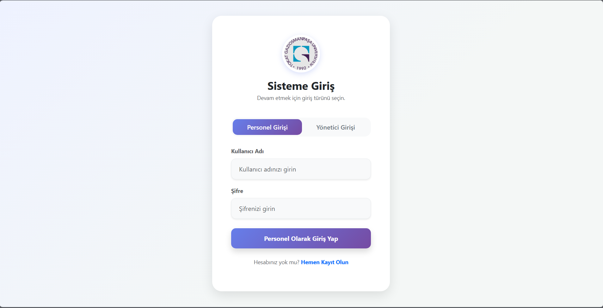
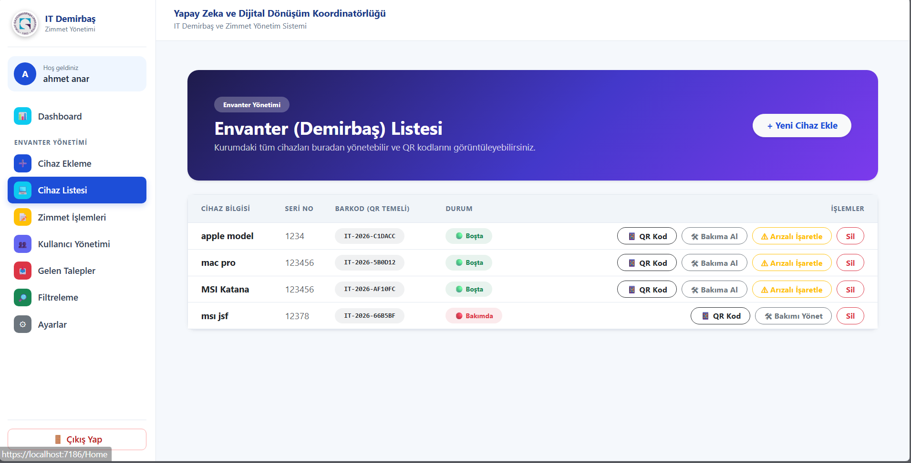
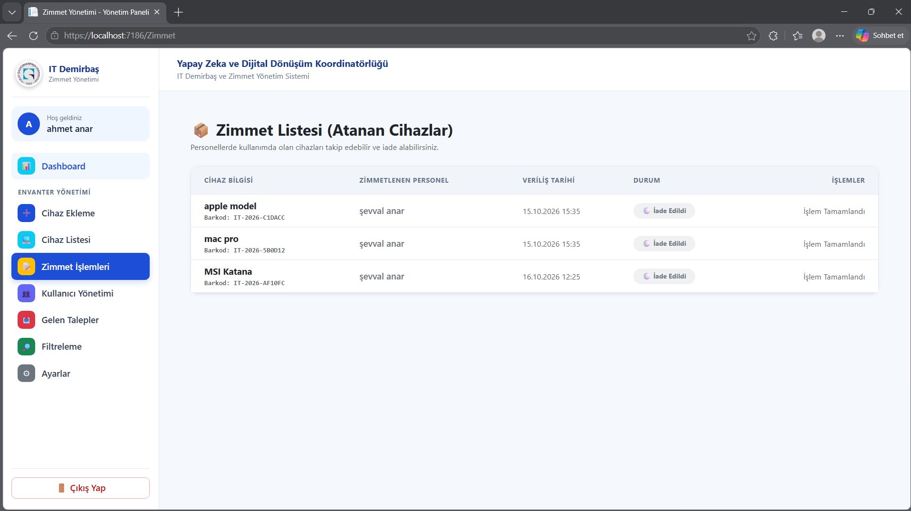

# ITAssetManagement - Docker & Run Guide

Bu repository, IT demirbaş ve zimmet yönetimi projelerinden oluşur.

Projeler:
- ITAssetManagement.API - Backend API
- ITAssetManagement.Web - Web uygulaması (MVC Views)

Önkoşullar
- Docker ve docker-compose yüklü olmalı
- (Geliştirme) Visual Studio 2026 veya dotnet 10 SDK

Ekran Görüntüleri
Aşağıdaki görseller uygulamadan alınıp `docs/` klasörüne eklenmelidir:

| Giriş | Envanter Listesi | Zimmet Yönetimi |
|-------|------------------|-----------------|
|  |  |  |

Hızlı Başlatma (Docker)
1. `.env.example` dosyasını `.env` olarak kopyalayın ve `SA_PASSWORD` ile `JWT_KEY` değerlerini değiştirin.
2. Kök dizinde terminal açın (PowerShell):
   docker compose up --build

3. Servisler ayağa kalktığında:
   - API: http://localhost:7041 (Swagger: http://localhost:7041/swagger)
   - Web: http://localhost:7187

Ortam Değişkenleri
- SA_PASSWORD ve JWT_KEY zorunludur ve `.env` dosyasından okunur. Eksikse compose başlamaz.
- `.env` dosyası `.gitignore` ile repo dışında tutulur; şablon olarak `.env.example` kullanılır.
- SA_PASSWORD değiştirildiğinde SQL Server volume'u eski şifreyle oluşturulmuş olabilir; bu durumda `docker compose down -v` ile volume silinmelidir.
- API konteyneri ConnectionStrings__DefaultConnection ve Jwt__Key çevresel değişkenlerini kullanır.
- Web konteyneri ApiBaseUrl ile API adresini kullanır (`http://api:80/api/`).

Notlar
- İlk açılışta API, veritabanını migration ile otomatik oluşturur.
- Kamera ile QR okutma özelliği mobil uygulamada geliştirilecektir. Bu depoda barkoda göre cihaz sorgulama uç noktası (`GET api/Demirbaslar/Barkod/{barkod}`) hazırdır.

Docker ile geliştirme
- Eğer Visual Studio içinde debug yapıyorsanız, Dockerfile ve docker-compose dosyalarını Visual Studio'ya import edebilirsiniz.

Proje Yapısı
- ITAssetManagement.Core - Varlık (entity) ve ortak modeller
- ITAssetManagement.Data - Entity Framework Core DbContext ve migration'lar
- ITAssetManagement.API - REST API, JWT kimlik doğrulama, Swagger
- ITAssetManagement.Web - MVC arayüzü; API'ye JWT ile istek gönderir

Kimlik Doğrulama
- API, giriş yapıldığında JWT üretir.
- Web uygulaması cookie ile oturum tutar ve API çağrılarına JWT ekler.
- API'deki korumalı uç noktalar token olmadan 401 döner; bu beklenen davranıştır.

Sorun giderme
- API konteyneri DB bağlantısı hatası veriyorsa, sqlserver konteynerinin tamamen hazır olduğunu (healthcheck) bekleyin veya connection string bilgilerini kontrol edin.
- "Address already in use" hatası alırsanız Visual Studio ile Docker aynı portları kullanıyor olabilir. Visual Studio'da başka bir profil çalıştırın veya Docker portlarını `docker-compose.yml` içinde değiştirin.
- Web konteyneri LocalDB'ye bağlanmaya çalışıyorsa `ConnectionStrings__DefaultConnection` değerinin Docker'daki SQL Server adresini (`sqlserver`) gösterdiğini kontrol edin.
- Kimlik doğrulama hatalarında `JWT_KEY` değerinin API ve Web için aynı olduğundan emin olun.
- Sıfırdan başlamak için: `docker compose down -v` ardından `docker compose up --build`.

Geliştirici Notları
- `.env` dosyasını asla commit etmeyin; gizli değerleri yalnızca yerelde tutun.
- Görsel dosya adlarında Türkçe karakter kullanmayın; README bağlantıları dosya adıyla birebir eşleşmelidir.
## 🔑 Test Kullanıcı Bilgileri (Admin)
Proje ilk kez çalıştırıldığında (Docker veya Migration ile) veritabanı otomatik olarak oluşur ve sisteme giriş yapabilmeniz için varsayılan bir yönetici hesabı otomatik olarak tanımlanır:
- **Kullanıcı Adı:** `admin`
- **Şifre:** `123456`
- **Rol:** `Admin`
